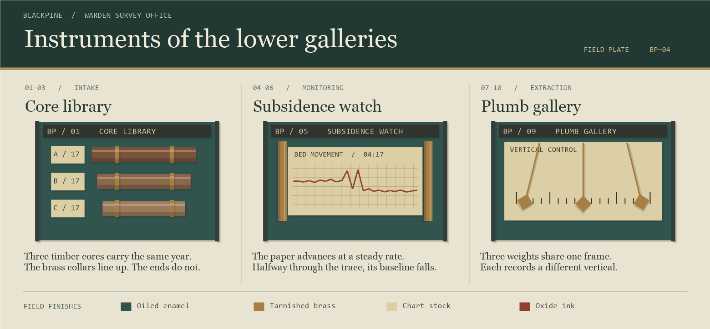

# Blackpine Survey Works

First environment art pass for the generated bunker beneath the warden’s cottage. The forest stakes and the lift already suggest someone measured this place. Downstairs, the player finds the instruments they used and can see where the readings stopped making sense.

The field plate is an offline elevation drawn from the in-game instrument geometry, colors, type and chart marks. Lighting and sight lines in Team Create still need visual review.

## Walking the lower galleries

| Rooms in a ten-room run | Architecture | What the flashlight finds |
| --- | --- | --- |
| 1–3 · Core library | Timber lintel, two iron shoes and oxidized uprights. A warm hood light picks out the cabinet. | Three increment cores from the same survey year. Their collars agree and their ends fall at different lengths. |
| 4–6 · Subsidence watch | A parallel cable return crosses the steel portal on pale ceramic bridges. | A paper recorder carries an oxide-red trace. At 04:17 the pen jumps, then resumes its rhythm on a lower baseline. |
| 7–10 · Plumb gallery | One half of the overhead lintel sits lower than the other. A splice plate bridges the step. | Three brass plumb bobs hang across the same graduated scale. Each points to a different vertical. |

The hardware uses oil-green enamel, dark iron and dull brass. Reserve pale chart stock for surfaces the player can read at arm’s length. The inspection lamp reaches seven studs and points down across the cabinet. Give the player a dark stretch between pools of light so the flashlight still does useful work. The stage follows the fraction of the generated route if a run produces fewer rooms.

## Creative Lead handoff

- **Let a room dress itself.** The server probes the generated room’s own floor and side walls near its entrance. A single suitable wall supports an instrument bay. Two opposing walls support a lintel. Low bays and open spaces skip automatic placement.
- **Choose the camera view.** For a precise cabinet location, add an Attachment named `SurveyMount` to a part in the room template. Set its center roughly four studs above the floor and its front (local −Z) toward the walkway. Leave space for a case about four studs wide, with its reading lamp above. The attachment works even without a suitable automatic bay.
- **Take over a room.** Set the boolean attribute `SurveyDressing` to `false` on any template receiving a fully authored art pass. Its generated clones will skip the entire installation.
- **First visual review.** Check the recorder from the lift-side approach, read its trace under the flashlight, and check the late lintel from both directions. Adjust the mount if authored furniture covers the case. The late plumb lines and the split lintel should read together in one view.

## Implementation and verification

`SurveyGallery` adds the bays after the room chain, NPCs and clues have been placed. Each fitting lives under its generated room and streams and resets with that room. All new parts are anchored, non-colliding and excluded from physics queries and touch events. The print graphics and physical assets are authored in Luau and use Roblox materials and fonts.

The headless fixture check exercised all ten stations, the three structural variations, repeated installation, missing walls, low ceilings, a single wall, an explicit mounting point and a template opt-out. The ten-room fixture produced 229 decorative parts. This count describes that fixture. Published layouts can use fewer, depending on the available walls. The Milestone 3 gameplay handoff is in [the release notes](milestone-3-release.md).
